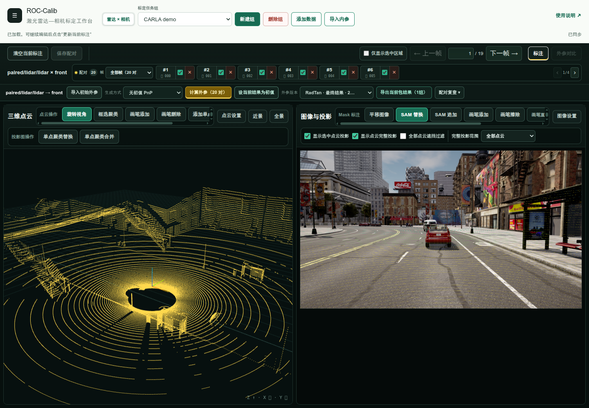

# ROC-Calib

**Camera–LiDAR calibration from operator-confirmed regions**

[中文](README_zh-CN.md) · [Paper solver](docs/paper-solver.md) · [Workbench](docs/usage.md) · [Results](docs/results.md)

This repository now includes the **2026-10-26 paper solver**: all-point PnP, coarse region alignment, fine region + sampling-aware bounded contour optimization, and boundary-preserving refinement. The solver is standalone C++17, runs on CPU, and uses no supplied extrinsic estimate or LiDAR intensity. It has no gradient-sampling continuation or internal time cutoff.

## Run the paper solver (Linux / WSL)

```sh
sudo apt-get install build-essential cmake libeigen3-dev libopencv-dev libssl-dev libblas-dev liblapack-dev
cmake -S native -B build/native -DCMAKE_BUILD_TYPE=Release
cmake --build build/native -j4
python3 tools/download_demo.py
OPENBLAS_NUM_THREADS=1 OMP_NUM_THREADS=1 build/native/autocalib_native \
  --root demo/carla --group 6 --output outputs/paper-carla.json
```

Python is used only by the existing optional asset downloader. Data reading, PnP, optimization and verification execute in C++ without Python. The final row-major camera-from-LiDAR matrix is `solve.matrix`; translation is in meters. See [input format, provenance and validation](docs/paper-solver.md).

## Paper results

Ten groups, 220 object pairs, 34,178 selected points: mean **RRE 0.4062°**, mean **RTE 0.04655 m**. RRE is the sum of absolute intrinsic ZYX Euler angles of the relative rotation, not the geodesic rotation angle. [Per-group archived results](docs/results.md).

## Annotation and calibration workbench



Run `./start.sh` (or `./start.sh --cpu`) and open http://localhost:3000. The **计算外参** button runs the same C++ binary as the paper CLI. Choose **无初值 PnP** for the paper workflow. **基于初始外参精调** starts the same optimization from your selected transform. To update an existing installation, pull `main` and rerun the start command. UI backend migration is not part of this source release. [Workbench instructions](docs/usage.md).

The standalone Python command `roc-calib` still uses the legacy region-only solver. Its results and commands remain documented in [legacy results](docs/legacy-results.md). Their rotation metric differs from the current paper metric.

## License

[MIT](LICENSE) for project code. Vendored numerical dependencies retain their own notices in `native/vendor`; external models and datasets retain their own licenses. [Third-party notices](NOTICE.md).
